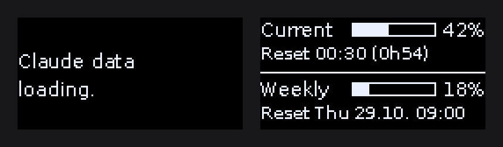
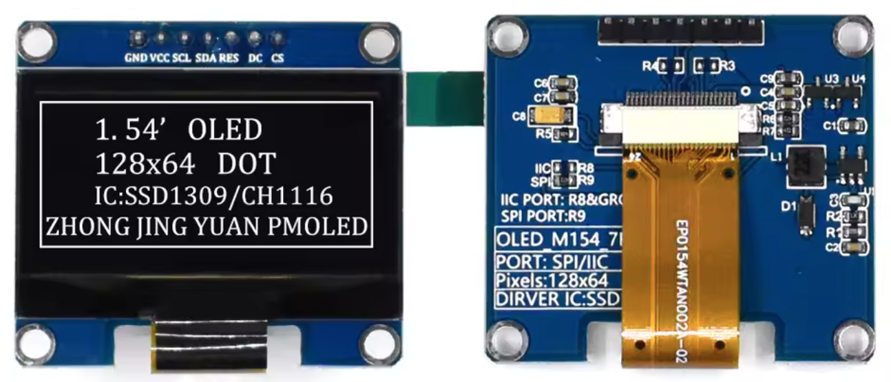
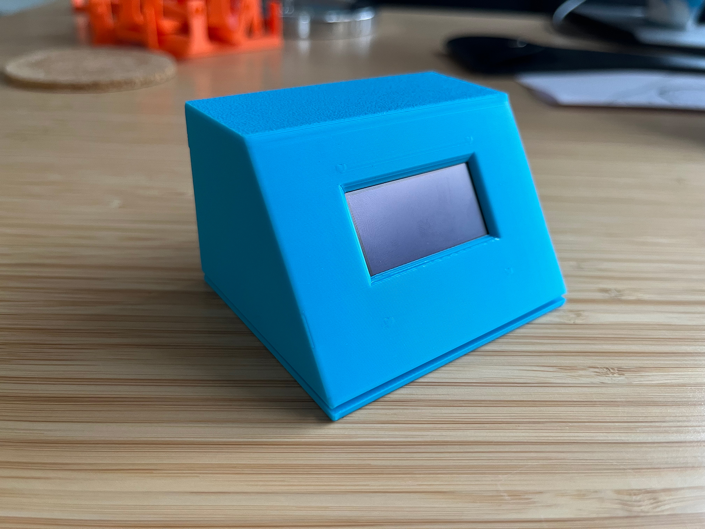
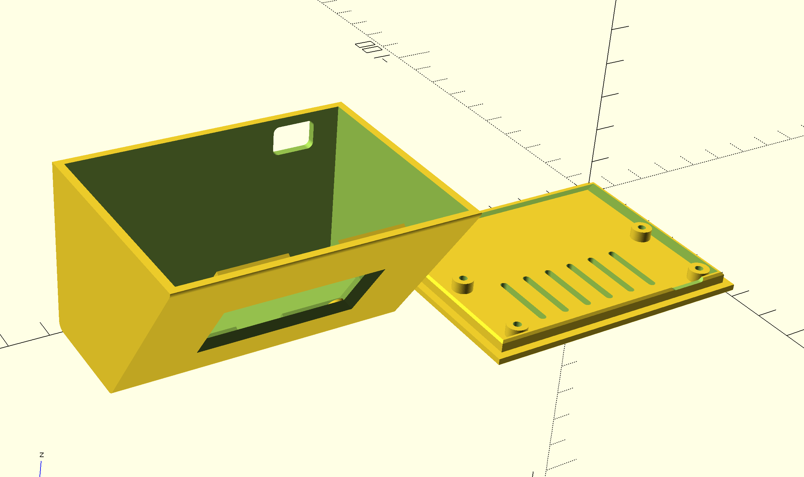
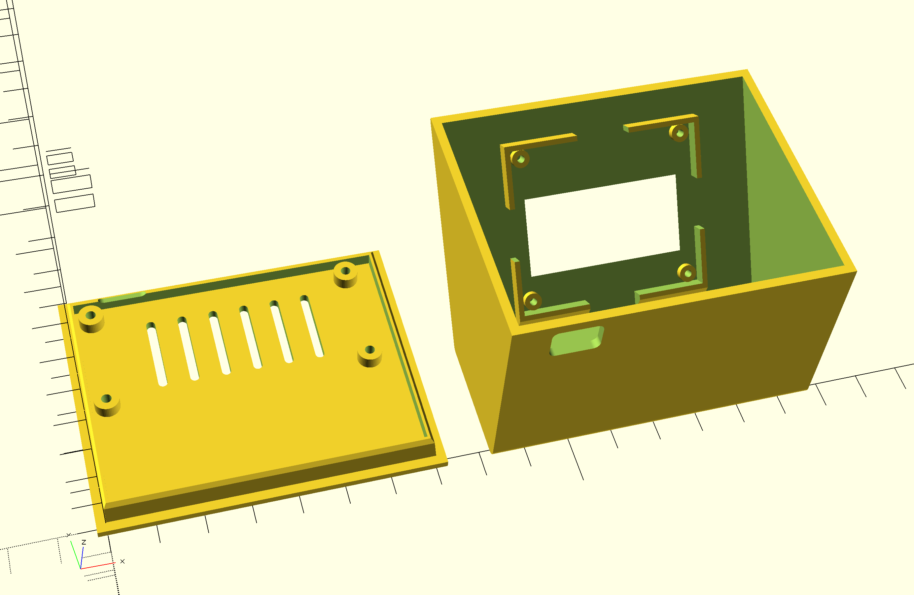
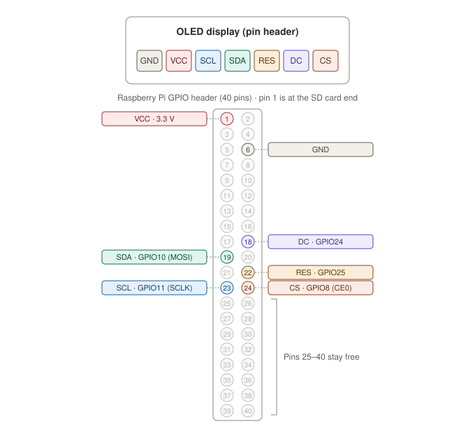

# AI Usage Monitor

I built a small desk display for my Claude usage limits using a **Raspberry Pi Zero W** and a **1.54" OLED display (oled_m154_7p, 7-pin SPI, 128×64)**. Once the Pi boots and joins my Wi-Fi, it automatically shows my **current** (5-hour) and **weekly** usage, each with a progress bar and the time when it resets. No keyboard, monitor or browser needed.



*Left to right: loading screen at boot and the usage display.*

## What it shows

| Line | Meaning |
|---|---|
| `Current 42%` | Usage of the rolling 5-hour session window |
| `Reset 00:30 (0h54)` | When that window resets, plus a live countdown |
| `Weekly 18%` | Usage of the rolling 7-day window |
| `Reset Thu 29.10. 09:00` | When the weekly limit resets |

The values are fetched every 2 minutes. Until the first data arrives, the display shows `Loading...`.

## How it works

Claude Code shows your limits with `/usage`. Behind that is an **undocumented** endpoint (`https://api.anthropic.com/api/oauth/usage`) that returns the same numbers. The script calls this endpoint with your Claude login credentials and keeps the login fresh by refreshing the token itself.

> [!CAUTION]
> This is not an official Anthropic API and this project is not affiliated with Anthropic. The endpoint may change or disappear at any time, which would break the display until the script is updated. It only works with Claude subscription plans (Pro/Max), not with API keys.

## Repository contents

| File | Purpose |
|---|---|
| `display_usage/monitor.py` | `UsageMonitor`: fetches the usage and keeps the display updated |
| `display_usage/api.py` | `ClaudeApi`: credentials, token refresh and usage requests |
| `display_usage/display.py` | `Oled_m154_7p`: OLED setup and drawing |
| `display_usage/utils.py` | Shared helpers: logging, font loading, reset time formatting |
| `show_my_usage.py` | Your own start script with your settings (you create it in step 6, not in git) |
| `credentials.example.json` | Shape of the credentials file |
| `pyproject.toml` / `uv.lock` | Development tools and settings (managed with [uv](https://docs.astral.sh/uv/)); the Pi uses Debian's system packages |
| `Makefile` | Shortcuts for formatting and checking code (`make help`) |
| `3Dprint/pizero_oled154_case.scad` | OpenSCAD source of the case (adjustable) |
| `3Dprint/pizero_oled154_case.stl` | Ready-to-print case (body and bottom plate) |

## Hardware

- Raspberry Pi Zero W or Zero 2 W (the plain Zero has no Wi-Fi)
- 1.54" OLED, 128×64, 7-pin SPI (SSD1309 controller; SSD1306 variants work with a one-line change)
- microSD card, power supply, 7 female-to-female jumper wires (or soldered header)



*The display module used here (front and back). The back is labeled `OLED_M154_7P`.*

The OLED is monochrome. The text color (white, blue, yellow, green…) is fixed by the display you buy and cannot be changed in software.

For the case (optional):

- 3D printer
- 4× M2.5 self-tapping screws (Pi), 4× M2 self-tapping screws (display)

## Case

The [`3Dprint`](3Dprint/) folder contains a 3D-printable desk case. It's a wedge: the display sits in the front face, which leans back 35° like a small monitor. The Pi lies flat on the bottom plate behind it, with its power port in the back wall. With the default settings the case is about 74 × 55 × 52 mm (W × D × H).



*The printed case.*





## Setup

### 1. Set up the Raspberry Pi

Your Raspberry Pi must already be set up, and you need an SSH connection to it.

### 2. Wire the display

Pin 1 of the Pi header is the corner pin on the SD-card end of the board. Odd pins are on the inner row, even pins on the outer edge.



Pins 25–40 stay free. The pin order on the display itself can differ between sellers, so go by the labels printed on your board.

### 3. Install the software

```bash
sudo raspi-config nonint do_spi 0
sudo apt update
sudo apt install -y git fonts-dejavu-core python3-luma.core python3-luma.oled

git clone https://github.com/deluge/ai-usage-monitor.git ~/ai-usage-monitor
```

The script runs with the system-wide `python3`, so the Python packages are installed with `apt` (via `sudo`) instead of a virtual environment.

### 4. Get your Claude login credentials

You need [Claude Code](https://claude.com/claude-code) on your computer, logged in with your Claude account (run `claude`, then `/login`). A token from `claude setup-token` does **not** work: it lacks the permission for usage data and returns HTTP 403.

Read the stored credentials on your computer:

- **macOS** (stored in the Keychain, not as a file):
  ```bash
  security find-generic-password -s "Claude Code-credentials" -w
  ```
- **Windows**: `%USERPROFILE%\.claude\.credentials.json` (hidden file; in PowerShell: `notepad $env:USERPROFILE\.claude\.credentials.json`)
- **Linux**: `cat ~/.claude/.credentials.json`

The output is a JSON object containing `claudeAiOauth`.

> [!IMPORTANT]
> These credentials give full access to your Claude account. Never commit them to Git or share them. The `.gitignore` excludes `credentials.json`.

### 5. Put the credentials on the Pi

```bash
mkdir -p ~/.usage-monitor
nano ~/.usage-monitor/credentials.json
chmod 600 ~/.usage-monitor/credentials.json
```

In the file, change the value after `"expiresAt":` to `0`. This makes the Pi refresh the token right away, so it gets its own login (see [Sharing the login](#sharing-the-login-between-pi-and-computer)). The result looks like `credentials.example.json`.

### 6. Create your start script

`show_my_usage.py` in the project folder starts the display with your own settings. It is listed in `.gitignore`, so `git pull` never overwrites it. Create it:

```bash
nano ~/ai-usage-monitor/show_my_usage.py
```

Paste the following content and save. It uses the default for every setting:

```python
from display_usage.api import ClaudeApi
from display_usage.display import Oled_m154_7p
from display_usage.monitor import UsageMonitor


api = ClaudeApi()
oled = Oled_m154_7p()

monitor = UsageMonitor(api, oled)
monitor.run()
```

To change a setting, pass it to the class. All settings and their defaults are listed under [Configuration](#configuration). For example:

```python
oled = Oled_m154_7p(contrast=100, rotate=2)
```

Test it (Ctrl+C to stop):

```bash
cd ~/ai-usage-monitor
python3 show_my_usage.py
```

### 7. Start on boot

Create the service file:

```bash
sudo nano /etc/systemd/system/usage-monitor.service
```

Paste the following content, replace every `pi` with your username on the Pi, and save:

```ini
[Unit]
Description=Claude usage on OLED
Wants=network-online.target
After=network-online.target

[Service]
User=pi
WorkingDirectory=/home/pi/ai-usage-monitor
ExecStart=/usr/bin/python3 /home/pi/ai-usage-monitor/show_my_usage.py
Restart=always
RestartSec=10

[Install]
WantedBy=multi-user.target
```

Then enable and start the service:

```bash
sudo systemctl daemon-reload
sudo systemctl enable --now usage-monitor
```

### 8. Log in again on your computer

Once the Pi has refreshed its token, open Claude Code on your computer and run `/login` once. Use `/login`, not `/logout`, since logging out may revoke the shared session.

## Sharing the login between Pi and computer

Both devices start out with the same login. When one of them refreshes the token, the other one's copy becomes invalid. Setting `expiresAt` to `0` lets the Pi refresh first; a fresh `/login` on the computer then gives the computer its own session. After that, both run independently.

You only need to copy the credentials again if the Pi was off for a long time (weeks), or if you change your password or log out everywhere. The display will show `HTTP 401` in that case.

## Configuration

All settings are in your `show_my_usage.py` (step 6). Restart the service after a change: `sudo systemctl restart usage-monitor`.

**`ClaudeApi`**

| Setting | Default | Meaning |
|---|---|---|
| `credentials_file` | `~/.usage-monitor/credentials.json` | Where your login credentials are stored |
| `timeout` | `20` | Seconds to wait for an API response |

**`Oled_m154_7p`**

| Setting | Default | Meaning |
|---|---|---|
| `controller` | `ssd1309` | Display controller; use `ssd1306` if the display stays black |
| `contrast` | `200` | Display brightness (0–255) |
| `rotate` | `0` | Rotation in steps of 90°; `2` turns the picture upside down |
| `gpio_data_command` | `24` | GPIO of the DC pin |
| `gpio_reset` | `25` | GPIO of the RES pin |
| `spi_port` | `0` | SPI bus |
| `spi_device` | `0` | Chip select: `0` = CE0 (GPIO8), `1` = CE1 (GPIO7) |
| `bus_speed_hz` | `8000000` | SPI clock; lower it if the picture shows glitches |

**`UsageMonitor`**

| Setting | Default | Meaning |
|---|---|---|
| `api_request_interval` | `120` | Seconds between API requests (don't go too low) |
| `display_refresh_interval` | `30` | Seconds between screen redraws (updates the countdown) |

## Troubleshooting

| Display / log | Likely cause | Fix |
|---|---|---|
| Stays black | Wrong controller, SPI off or wiring | Set `controller="ssd1306"`; check `ls /dev/spidev*`; recheck wiring and 3.3 V |
| `No credentials` | File missing | Create `~/.usage-monitor/credentials.json` (step 5) |
| `HTTP 403` | `setup-token` used, or request blocked | Use the `claudeAiOauth` login credentials (step 4) |
| `HTTP 401` | Token invalid or expired | Copy fresh credentials, set `expiresAt` to `0`, restart |
| `Token refresh at …: HTTP 404` in the log | Anthropic changed the refresh URL | Update `TOKEN_URLS` in `display_usage/api.py` |
| `Loading...` forever | No network | Check Wi-Fi; see `journalctl -u usage-monitor` |

## Development

The Pi doesn't need any of this; it's only for working on the code on your computer. Install [uv](https://docs.astral.sh/uv/), then:

```bash
uv venv
make devinstall   # installs ruff and ipdb into .venv
make check        # check formatting and lint rules (same as the GitHub workflow)
make correct      # fix formatting and lint issues
```
