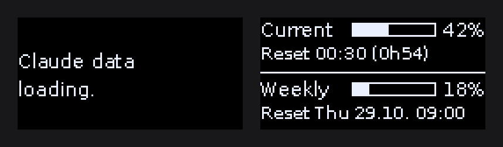
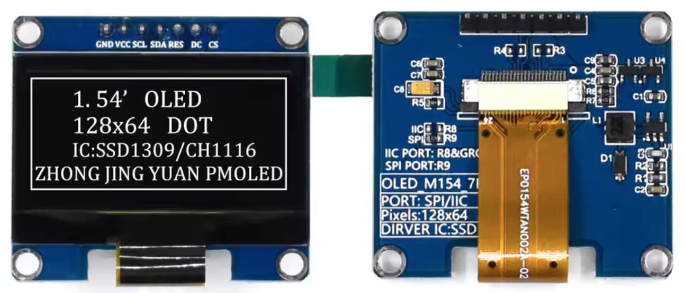

# AI Usage Monitor

I built a small desk display for my Claude usage limits using a **1.54" OLED display (oled_m154_7p, 7-pin SPI, 128×64)**, driven either by a **Raspberry Pi Zero W** or an **ESP32-C3 Super Mini**. Once the board starts and joins my Wi-Fi, it automatically shows my **current** (5-hour) and **weekly** usage, each with a progress bar and the time when it resets. No keyboard, monitor or browser needed.



*Left to right: loading screen at boot and the usage display (Raspberry Pi version).*

## Choose your board

This README covers everything both boards have in common. The board-specific steps (hardware, wiring, installation, configuration) are in separate guides:

| Board | Runs | Guide |
|---|---|---|
| Raspberry Pi Zero W / Zero 2 W | Python 3 on Raspberry Pi OS, started by systemd | [README_RASPBERRY_PI.md](README_RASPBERRY_PI.md) |
| ESP32-C3 Super Mini | MicroPython, starts on power-up | [README_ESP32_C3.md](README_ESP32_C3.md) |

The Pi version is easier to debug over SSH. The ESP32 is cheaper, smaller, uses less power and is ready a few seconds after you plug it in.

## What it shows

| Line | Meaning |
|---|---|
| `Current 42%` | Usage of the rolling 5-hour session window |
| `Reset 00:30 (0h54)` | When that window resets, plus a live countdown |
| `Weekly 18%` | Usage of the rolling 7-day window |
| `Reset Thu 29.10. 09:00` | When the weekly limit resets |

The values are fetched every 2 minutes. Until the first data arrives, the display shows `Loading...`. Both boards use the same font (DejaVu Sans) and layout, so the display looks the same on either.

## How it works

Claude Code shows your limits with `/usage`. Behind that is an **undocumented** endpoint (`https://api.anthropic.com/api/oauth/usage`) that returns the same numbers. The board calls this endpoint with your Claude login credentials and keeps the login fresh by refreshing the token itself.

> [!CAUTION]
> This is not an official Anthropic API and this project is not affiliated with Anthropic. The endpoint may change or disappear at any time, which would break the display until the code is updated. It only works with Claude subscription plans (Pro/Max), not with API keys.

## Repository contents

| File | Purpose |
|---|---|
| `display_usage/monitor.py` | `UsageMonitor`: fetches the usage and keeps the display updated |
| `display_usage/api.py` | `ClaudeApi`: credentials, token refresh and usage requests |
| `display_usage/display.py` | `BaseDisplay`: the screen layout, drawn with a few primitives each board implements |
| `display_usage/settings.py` | Reads `settings.json` and creates the monitor, display, API and Wi-Fi from it |
| `display_usage/utils.py` | Shared helpers: logging, time and `Timezone`, reset time formatting |
| `display_usage/errors.py` | Exceptions shared by the modules above |
| `display_usage/pizerow/app.py` | Starts the display on the Pi (called by your `main.py`) |
| `display_usage/pizerow/display.py` | `Oled_m154_7p` for the Raspberry Pi (luma.oled, TrueType fonts) |
| `display_usage/esp32/app.py` | Starts the display on the ESP32 (called by your `main.py`) |
| `display_usage/esp32/display.py` | `Oled_m154_7p` for the ESP32 (MicroPython's `ssd1306` driver with the SSD1309 setup the Pi uses) |
| `display_usage/esp32/wifi.py` | `Wifi`: Wi-Fi connection and clock sync on the ESP32 |
| `display_usage/esp32/font.py` | `BitmapFont`: draws the bitmap fonts below |
| `display_usage/esp32/dejavu_sans_*.py` | DejaVu Sans as bitmap fonts for the ESP32 (generated) |
| `tools/make_esp32_fonts.py` | Generates the ESP32 bitmap fonts from `DejaVuSans.ttf` |
| `settings.example.esp32.json` / `settings.example.pi.json` | Examples for your `settings.json` |
| `Makefile` | Development commands and the ESP32 install and update commands (`make help`) |
| `credentials.example.json` | Shape of the credentials file |
| `testing/` | Tests and the fakes they run with (see [Development](#development)) |
| `pyproject.toml` / `uv.lock` | Development tools and settings (managed with [uv](https://docs.astral.sh/uv/)); the boards don't use them |
| `3Dprint/pizero_oled154_case.scad` | OpenSCAD source of the Pi case (adjustable) |
| `3Dprint/pizero_oled154_case.stl` | Ready-to-print Pi case (body and bottom plate) |
| `3Dprint/esp32c3_oled154_wedge.scad` / `.stl` | ESP32 case, a smaller version of the Pi case ([details](README_ESP32_C3.md#case)) |

## The display

Both boards use the same display:

- 1.54" OLED, 128×64, 7-pin SPI (SSD1309 controller; SSD1306 variants work too)
- 7 female-to-female jumper wires (or soldered header)



*The display module used here (front and back). The back is labeled `OLED_M154_7P`.*

The OLED is monochrome. The text color (white, blue, yellow, green…) is fixed by the display you buy and cannot be changed in software.

The pin order on the display can differ between sellers, so always wire by the labels printed on your board: `GND`, `VCC`, `SCL` (SPI clock), `SDA` (SPI data), `RES` (reset), `DC` (data/command) and `CS` (chip select). It accepts **3.3–5 V** on `VCC` (it has its own voltage regulator); the board guides show which pin to use.

## Get your Claude login credentials

Both boards need a copy of your Claude login. The board guides tell you when to do this.

You need [Claude Code](https://claude.com/claude-code) on your computer, logged in with your Claude account (run `claude`, then `/login`). A token from `claude setup-token` does **not** work: it lacks the permission for usage data and returns HTTP 403.

Read the stored credentials on your computer:

- **macOS** (stored in the Keychain, not as a file):
  ```bash
  security find-generic-password -s "Claude Code-credentials" -w
  ```
- **Windows**: `%USERPROFILE%\.claude\.credentials.json` (hidden file; in PowerShell: `notepad $env:USERPROFILE\.claude\.credentials.json`)
- **Linux**: `cat ~/.claude/.credentials.json`

The output is a JSON object containing `claudeAiOauth`. When you save it as `credentials.json` in the project folder, change the value after `"expiresAt":` to `0`. This makes the board refresh the token right away, so it gets its own login (see [Sharing the login](#sharing-the-login-between-board-and-computer)). The result looks like `credentials.example.json`.

> [!IMPORTANT]
> These credentials give full access to your Claude account. Never commit them to Git or share them. The `.gitignore` excludes `credentials.json`.

## Log in again on your computer

Once the board has refreshed its token (the display shows your usage), open Claude Code on your computer and run `/login` once. Use `/login`, not `/logout`, since logging out may revoke the shared session.

## Sharing the login between board and computer

Both devices start out with the same login. When one of them refreshes the token, the other one's copy becomes invalid. Setting `expiresAt` to `0` lets the board refresh first; a fresh `/login` on the computer then gives the computer its own session. After that, both run independently.

You only need to copy the credentials again if the board was off for a long time (weeks), or if you change your password or log out everywhere. The display will show `HTTP 401` in that case.

## Configuration

On both boards your own files live in the project folder: `main.py` starts the display (create it from the board guide), `settings.json` holds your settings and `credentials.json` your Claude login. They are listed in `.gitignore`, so they never end up in Git and `git pull` never overwrites them. The ESP32 gets copies of them (`make esp32-install`).

`settings.json` has one section per part, and every setting is optional; leave out what you don't change:

```json
{
	"timezone": {"utc_offset": 1, "dst": "eu"},
	"display": {"contrast": 100},
	"api": {"timeout": 20},
	"monitor": {"api_request_interval": 120}
}
```

The sections below are the same on both boards; the `display` and `wifi` (ESP32 only) sections are listed in the board guides. A misspelled setting stops the start with a message in the log.

**`api`**

| Setting | Default | Meaning |
|---|---|---|
| `credentials_file` | `credentials.json` | Where your login credentials are stored, relative to the project folder (Pi) or the board's root (ESP32) |
| `timeout` | `20` | Seconds to wait for an API response |

**`monitor`**

| Setting | Default | Meaning |
|---|---|---|
| `api_request_interval` | `120` | Seconds between API requests (don't go too low) |
| `display_refresh_interval` | `30` | Seconds between screen redraws (updates the countdown) |

**`timezone`**

| Setting | Default | Meaning |
|---|---|---|
| `utc_offset` | `null` | Your standard (winter) time offset from UTC in hours, e.g. `1` for Germany, `-5` for New York, `5.5` for India. `null` uses the system's timezone, which is right on the Pi; the ESP32 has none, so set it there |
| `dst` | `null` | Summer time rule: `"eu"` (last Sunday in March to last Sunday in October), `"us"` (second Sunday in March to first Sunday in November) or `null` |

## Troubleshooting

These apply to both boards. See the board guides for wiring, network and startup problems.

| Display / log | Likely cause | Fix |
|---|---|---|
| `No credentials` | File missing | Put the credentials on the board (see the board guide) |
| `HTTP 403` | `setup-token` used, or request blocked | Use the `claudeAiOauth` login credentials ([see above](#get-your-claude-login-credentials)) |
| `HTTP 401` | Token invalid or expired | Copy fresh credentials, set `expiresAt` to `0`, restart |
| `Token refresh at …: HTTP 404` in the log | Anthropic changed the refresh URL | Update `TOKEN_URLS` in `display_usage/api.py` |

## Development

The boards don't need any of this; it's only for working on the code on your computer. Install [uv](https://docs.astral.sh/uv/), then:

```bash
make devinstall   # installs pytest, ruff, ipdb and the ESP32 tools (esptool, mpremote, mpy-cross) into .venv (versions from uv.lock)
make check        # check formatting and lint rules (same as the GitHub workflow)
make correct      # fix formatting and lint issues
make tests        # run the tests (ARGS="-k monitor" to pass options to pytest)
make coverage     # run the tests with a coverage report (same as the GitHub workflow)
make esp32        # compile the ESP32 code with mpy-cross (same as the GitHub workflow)
```

The tests live in `testing/tests/` and run on your computer with plain Python 3, no board needed: HTTP requests go to a fake server (`testing/fakes/api.py`), the Pi display draws on luma's in-memory dummy device, and the ESP32 modules (`machine`, `network`, `framebuf`, ...) are replaced by fakes (`testing/fakes/micropython.py`).

### Code structure

Both boards run the same code. Everything in `display_usage/` runs on the Pi (Python 3) and on the ESP32 (MicroPython), so it only uses what MicroPython supports (no `datetime`, `threading` or `os.path`). Only the hardware-specific parts live in `display_usage/pizerow/` and `display_usage/esp32/`:

- `ClaudeApi` uses `requests`, which both Python 3 and MicroPython provide with the same interface.
- `UsageMonitor` runs one loop that fetches and redraws; on the ESP32 it also keeps the `Wifi` connected.
- Your `main.py` calls `main()` in the board's `app.py`, which reads `settings.json` and hands it to `build_monitor()` (`display_usage/settings.py`), which passes each section as keyword arguments to its class. So a new constructor argument is a new setting without further code.
- `BaseDisplay` draws the whole screen with five primitives (`clear`, `show`, `text`, `textlength`, `rectangle`). Each board's `Oled_m154_7p` implements them for its display driver. To support another display or board, write such a subclass.

The ESP32 has little memory: once the code is loaded and Wi-Fi is up, only about 100 KB are left, and each TLS connection needs most of it. MicroPython takes more memory for its own heap when that runs full and never gives it back, so the code on the board must stay small. That's why the ESP32 gets precompiled `.mpy` files (`make esp32`) and the fonts store their tables as `bytes` instead of tuples.

### ESP32 fonts

MicroPython can't read TTF fonts, so the ESP32 uses DejaVu Sans pre-rendered as bitmaps (`display_usage/esp32/dejavu_sans_*.py`). They are rendered with Pillow the same way the Pi draws text, so both displays show the same pixels. The glyph table is packed into `bytes` (7 bytes per character), which takes far less of the ESP32's memory than a tuple per character. The sizes come from `BaseDisplay.FONT_SIZE` and `SMALL_FONT_SIZE`. To regenerate them after changing those, download `DejaVuSans.ttf` and run from the project folder:

```bash
uv run --no-project --with pillow python -B -m tools.make_esp32_fonts /path/to/DejaVuSans.ttf
```
