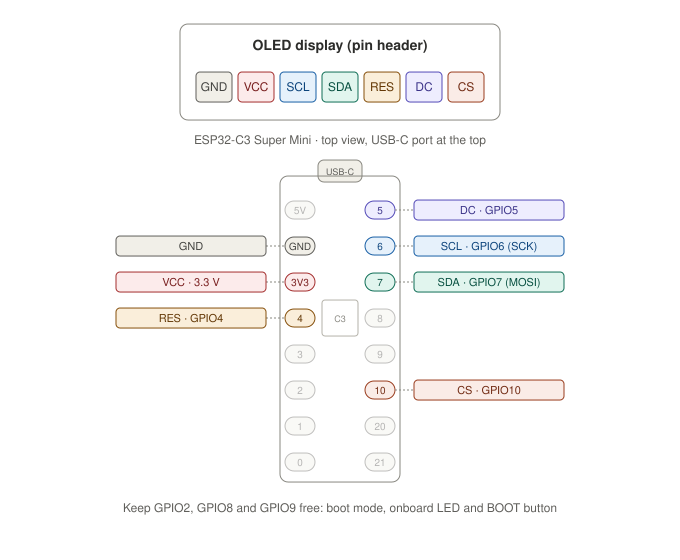

# AI Usage Monitor on an ESP32-C3 Super Mini

This guide covers the ESP32-C3 specific steps. Everything both boards have in common (what the display shows, the credentials, sharing the login, common settings) is in the main [README](README.md).

The ESP32 runs [MicroPython](https://micropython.org/) and the same code as the Pi ([`display_usage/`](display_usage/)). Only the display driver and the Wi-Fi connection are ESP32-specific ([`display_usage/esp32/`](display_usage/esp32/)). It brings the Pi's font (DejaVu Sans) along as bitmaps, so the display looks exactly the same.

## Hardware

- ESP32-C3 Super Mini (USB-C)
- The 1.54" OLED display ([details](README.md#the-display))
- USB-C cable (with data lines) and a USB power supply
- 7 female-to-female jumper wires (or soldered header)

There is no 3D-printable case for the ESP32 yet; the [Pi case](README_RASPBERRY_PI.md#case) doesn't have mounts or a port opening for it.

## Differences from the Pi version

- **Time:** The clock is set from the internet (NTP) and the timezone is set in your start script (see [`Timezone`](README.md#configuration)).
- **Security:** MicroPython's `requests` doesn't verify TLS certificates. Someone who controls your network could intercept the connection and read your Claude login. Only use the ESP32 on a network you trust. The credentials are also stored unencrypted in the ESP32's flash, so anyone who can plug into its USB port can read them.

## Setup

You do all of this from your computer, with the ESP32 connected over USB. Your computer needs these tools installed:

- [esptool](https://docs.espressif.com/projects/esptool/) to flash the firmware
- [mpremote](https://docs.micropython.org/en/latest/reference/mpremote.html) to copy files to the board

### 1. Flash MicroPython

Download the latest firmware `.bin` for **ESP32_GENERIC_C3** from [micropython.org/download/ESP32_GENERIC_C3](https://micropython.org/download/ESP32_GENERIC_C3/), then erase the board and write the firmware:

```bash
esptool --chip esp32c3 erase-flash
esptool --chip esp32c3 write-flash 0 ESP32_GENERIC_C3-<version>.bin
```

If esptool can't connect: hold the **BOOT** button, press and release **RESET**, then release **BOOT** and try again. Unplug and replug the board after flashing.

Check that MicroPython is running (Ctrl+] to exit):

```bash
mpremote repl
```

### 2. Wire the display

The Super Mini has two rows of pins. With the USB-C port at the top and the chip facing you, the left row is `5V`, `GND`, `3V3`, `GPIO4`–`GPIO0` and the right row is `GPIO5`–`GPIO10`, `GPIO20`, `GPIO21`.



GPIO6, 7 and 10 are the C3's native SPI pins. GPIO2, 8 and 9 stay free on purpose: they decide how the chip boots, GPIO8 drives the onboard LED and GPIO9 is the BOOT button. The pin order on the display and on the board can differ between sellers, so go by the labels printed on your boards. If you use other pins, set them in your start script (see [Configuration](#configuration)).

### 3. Copy the software to the ESP32

```bash
git clone https://github.com/deluge/ai-usage-monitor.git ~/ai-usage-monitor
cd ~/ai-usage-monitor

mpremote mip install ssd1306
mpremote cp -r display_usage :
```

`mip install ssd1306` installs the OLED driver; the `requests` and `ntptime` modules the code also needs are part of the MicroPython firmware. The `display_usage/pizerow/` folder is copied along but never used on the ESP32.

### 4. Get your Claude login credentials

Follow [Get your Claude login credentials](README.md#get-your-claude-login-credentials) in the main README.

### 5. Put the credentials on the ESP32

Save the credentials as `credentials.json` in the project folder (the `.gitignore` excludes it), change the value after `"expiresAt":` to `0`, then copy the file to the board and delete the local copy:

```bash
mpremote cp credentials.json :credentials.json
rm credentials.json
```

### 6. Create your start script

MicroPython runs `main.py` automatically when the board powers up. Create it in the project folder (listed in `.gitignore`, so `git pull` never overwrites it):

```bash
nano ~/ai-usage-monitor/main.py
```

Paste the following content, enter your Wi-Fi name and password, set your timezone and save:

```python
from display_usage.api import ClaudeApi
from display_usage.esp32.display import Oled_m154_7p
from display_usage.esp32.wifi import Wifi
from display_usage.monitor import UsageMonitor
from display_usage.utils import Timezone


wifi = Wifi("my-wifi-name", "my-wifi-password")
api = ClaudeApi()
oled = Oled_m154_7p(timezone=Timezone(utc_offset=1, dst="eu"))  # Central Europe

monitor = UsageMonitor(api, oled, wifi)
monitor.run()
```

The ESP32-C3 only supports 2.4 GHz Wi-Fi. All other settings and their defaults are listed under [Configuration](#configuration).

Test it without installing it yet (Ctrl+C to stop):

```bash
mpremote run main.py
```

The log shows the Wi-Fi connection, the clock sync and the token refresh; after a few seconds the display shows your usage.

### 7. Start on power-up

Copy the start script to the board and restart it:

```bash
mpremote cp main.py :main.py
mpremote reset
```

From now on the display starts whenever the ESP32 gets power; it doesn't need your computer anymore. To see its log, connect it to your computer and run `mpremote repl`.

### 8. Log in again on your computer

Follow [Log in again on your computer](README.md#log-in-again-on-your-computer) in the main README.

## Updating

```bash
cd ~/ai-usage-monitor
git pull
mpremote cp -r display_usage : + reset
```

Your `main.py` and `credentials.json` on the board stay untouched.

## Configuration

All settings are in your `main.py` (step 6). Copy it to the board again after a change (`mpremote cp main.py :main.py + reset`).

The `ClaudeApi`, `UsageMonitor` and `Timezone` settings are listed in the [main README](README.md#configuration). Set the `Timezone`: the ESP32 has no timezone database, so without it the reset times are shown in UTC.

**`Wifi`**

| Setting | Default | Meaning |
|---|---|---|
| `ssid` | (required) | Name of your Wi-Fi (2.4 GHz) |
| `password` | (required) | Wi-Fi password |
| `hostname` | `usage-monitor` | Name of the ESP32 in your network |
| `tx_power` | `None` | Wi-Fi transmit power in dBm; try `8.5` if the board doesn't connect (see [Troubleshooting](#troubleshooting)) |

**`Oled_m154_7p`**

| Setting | Default | Meaning |
|---|---|---|
| `timezone` | `Timezone()` (UTC on the ESP32) | Timezone for the reset times |
| `contrast` | `200` | Display brightness (0–255) |
| `flip` | `False` | `True` turns the picture upside down |
| `gpio_clock` | `6` | GPIO of the SCL pin |
| `gpio_data` | `7` | GPIO of the SDA pin |
| `gpio_chip_select` | `10` | GPIO of the CS pin |
| `gpio_data_command` | `5` | GPIO of the DC pin |
| `gpio_reset` | `4` | GPIO of the RES pin |
| `spi_bus` | `1` | Hardware SPI bus |
| `bus_speed_hz` | `8000000` | SPI clock; lower it if the picture shows glitches |

## Troubleshooting

See also the [common problems](README.md#troubleshooting) in the main README. To see the log, connect the board to your computer and run `mpremote repl`.

| Display / log | Likely cause | Fix |
|---|---|---|
| Stays black | Wiring, or `main.py` not on the board | Recheck wiring and 3.3 V; check that `mpremote ls` lists `main.py`, `credentials.json`, `display_usage/` and `lib/ssd1306.mpy` |
| `ImportError: no module named 'ssd1306'` | Driver missing | `mpremote mip install ssd1306` (step 3) |
| `No credentials` | File missing | Copy `credentials.json` to the board (step 5) |
| `Wi-Fi error` / `Wrong password` | Wrong password in `main.py` | Fix it and copy `main.py` again |
| `Wi-Fi error` / `Not found` | Wrong name, 5 GHz network, or weak signal | Use a 2.4 GHz network; check the name; try `tx_power=8.5` |
| `Loading...` forever, log keeps saying `Connecting to Wi-Fi` | Many Super Mini boards have a weak antenna design that fails at full transmit power | `Wifi(..., tx_power=8.5)` |
| `No network?` / `Network error` in the log | No internet, or the clock sync (NTP) failed | Check your router; the board keeps retrying |
| `MemoryError` in the log | Not enough free memory for the TLS connection | Reset the board; make sure no other code runs in `main.py` or `boot.py` |
| esptool can't connect | Board not in download mode | Hold BOOT, press RESET, release BOOT |
