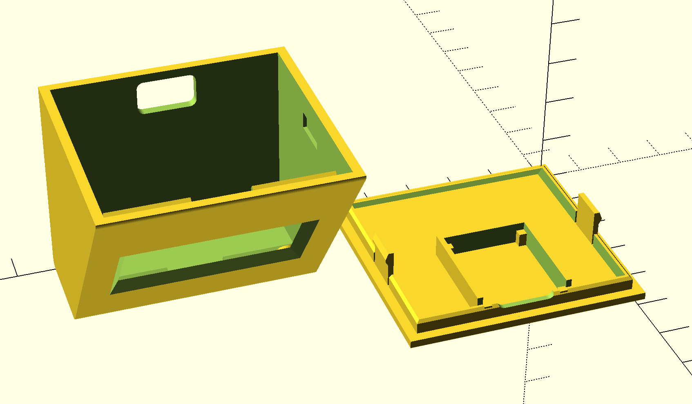
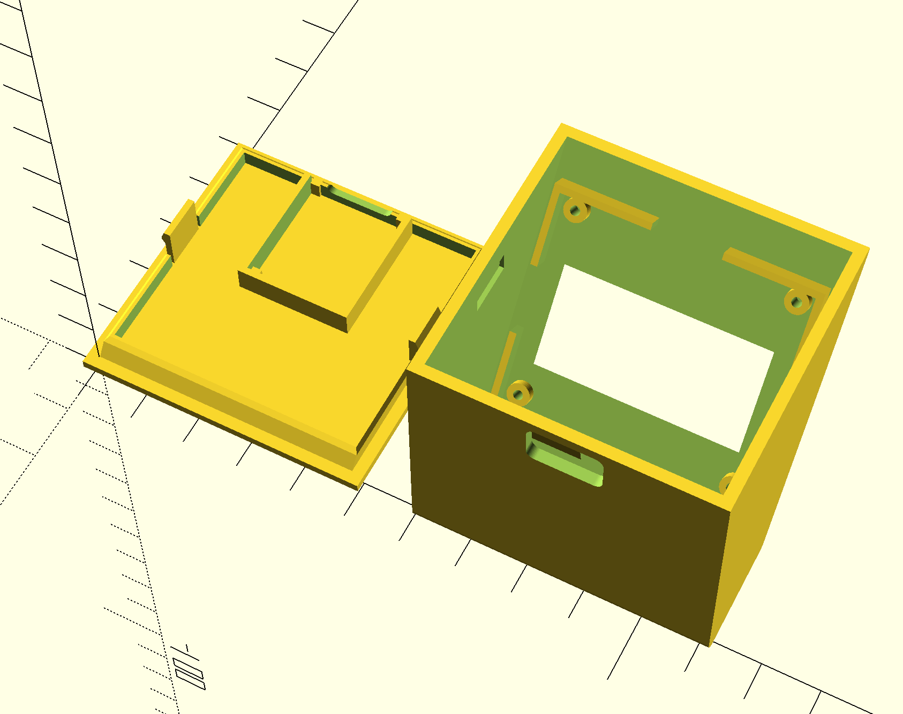
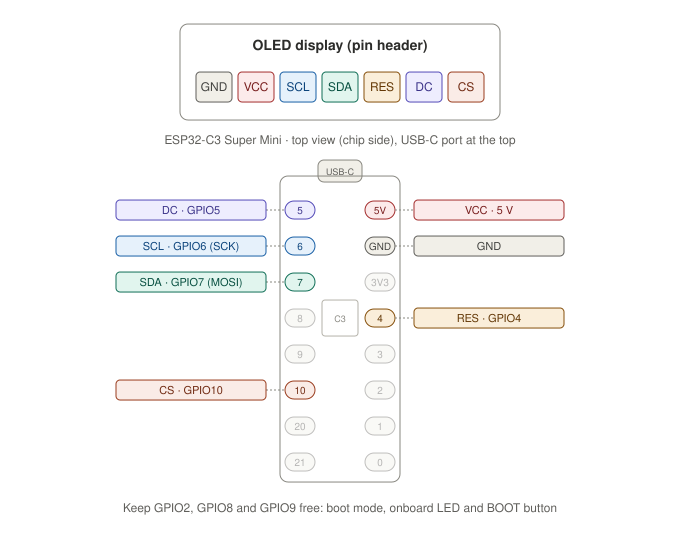

# AI Usage Monitor on an ESP32-C3 Super Mini

This guide covers the ESP32-C3 specific steps. Everything both boards have in common (what the display shows, the credentials, sharing the login, common settings) is in the main [README](README.md).

The ESP32 runs [MicroPython](https://micropython.org/) and the same code as the Pi ([`display_usage/`](display_usage/)). Only the display driver and the Wi-Fi connection are ESP32-specific ([`display_usage/esp32/`](display_usage/esp32/)). It brings the Pi's font (DejaVu Sans) along as bitmaps, so the display looks exactly the same.

## Hardware

- ESP32-C3 Super Mini (USB-C)
- The 1.54" OLED display ([details](README.md#the-display))
- USB-C cable (with data lines) and a USB power supply
- 7 female-to-female jumper wires (or soldered header)

For the case (optional):

- 3D printer
- 4× M2 self-tapping screws (display)
- Short jumper wires (10 cm), the case has little room for longer ones

## Case

The [`3Dprint`](3Dprint/) folder contains a 3D-printable desk case for the ESP32 (`esp32c3_oled154_wedge.scad` / `.stl`). It's a smaller version of the [Pi case](README_RASPBERRY_PI.md#case): the display leans back 35°, the ESP32 lies flat on the bottom plate behind it, with its USB-C port in the back wall. With the default settings it is about 52 × 51 × 46 mm (W × D × H); the depth comes from the Dupont plugs on the pin headers, which stand about 17 mm tall.





The ESP32 drops into a small holder on the bottom plate (the Super Mini has no mounting holes; add a drop of hot glue if it sits loose). The `.stl` file has both parts laid out ready to print, no supports needed: the body prints upside down, the bottom plate flat. The display is screwed in from behind with four M2 self-tapping screws, then the plate is pressed on until the two snap clips on its left and right click into the body. To open the case, pull the plate off firmly: the hooks are angled so they let go.

Open the `.scad` file in [OpenSCAD](https://openscad.org/) to adjust it (Window → Customizer):

- `chip_up`: set it to `false` if the header pins on your ESP32 point out of the bottom (soldered for a breadboard). The board is then held upside down, so the pins still point up.
- `esp_plug_h` / `disp_plug_h`: the height of the plugs. With wires soldered straight to the boards, set both to about `3` and the case gets about 10 mm shallower.
- `face_angle`: how far the display leans back.
- `clip_nub` / `clip_t`: how tight the snap clips hold. A bigger `clip_nub` holds tighter, a thinner `clip_t` snaps in more easily; `clips = false` leaves them out.
- `part = "section"` shows the assembled case cut in half, with the boards and the space for the plugs, to check that everything fits.

OpenSCAD prints the resulting size in its console.

## Differences from the Pi version

- **Time:** The clock is set from the internet (NTP) and the timezone is set in your `settings.json` (see [`timezone`](README.md#configuration)).
- **Security:** MicroPython's `requests` doesn't verify TLS certificates. Someone who controls your network could intercept the connection and read your Claude login. Only use the ESP32 on a network you trust. The credentials are also stored unencrypted in the ESP32's flash, so anyone who can plug into its USB port can read them.

## Setup

You do all of this from your computer, with the ESP32 connected over USB. Your computer needs these tools installed:

- [esptool](https://docs.espressif.com/projects/esptool/) to flash the firmware
- [mpremote](https://docs.micropython.org/en/latest/reference/mpremote.html) to copy files to the board
- [mpy-cross](https://pypi.org/project/mpy-cross/) to compile the code for the board. Its version should match the MicroPython firmware (check with `mpy-cross --version`)
- `make`, which macOS and Linux come with

```bash
pip install esptool mpremote mpy-cross
```

Or, with [uv](https://docs.astral.sh/uv/), run `make devinstall` in the project folder after step 3: it installs all three into the project's `.venv` at the versions in `uv.lock`, and the `make` commands find them there. Run esptool and mpremote from there with `uv run`, e.g. `uv run esptool …`.

### 1. Flash MicroPython

Download the latest firmware `.bin` for **ESP32_GENERIC_C3** from [micropython.org/download/ESP32_GENERIC_C3](https://micropython.org/download/ESP32_GENERIC_C3/), then erase the board and write the firmware:

```bash
esptool --chip esp32c3 erase-flash
esptool --chip esp32c3 write-flash 0 ESP32_GENERIC_C3-<version>.bin
```

If esptool can't connect: hold the **BOOT** button, press and release **RESET**, then release **BOOT** and try again. Unplug and replug the board after flashing.

Check that MicroPython is running (Ctrl+] to exit):

```bash
mpremote repl
```

### 2. Wire the display

The Super Mini has two rows of pins. With the USB-C port at the top and the chip facing you, the left row is `GPIO5`–`GPIO10`, `GPIO20`, `GPIO21` and the right row is `5V`, `GND`, `3V3`, `GPIO4`–`GPIO0`.



VCC goes to `5V`: the 1.54" display modules have their own voltage regulator (a small 3-pin chip on the back, often labeled `662K`) and accept 3.3–5 V. Only if your module has no regulator, use `3V3` instead. The data pins work with the ESP32's 3.3 V signals either way. GPIO6, 7 and 10 are the C3's native SPI pins. GPIO2, 8 and 9 stay free on purpose: they decide how the chip boots, GPIO8 drives the onboard LED and GPIO9 is the BOOT button. The pin order on the display and on the board can differ between sellers, so go by the labels printed on your boards. If you use other pins, set them in your settings (see [Configuration](#configuration)).

### 3. Get the code

```bash
git clone https://github.com/deluge/ai-usage-monitor.git ~/ai-usage-monitor
cd ~/ai-usage-monitor
```

### 4. Get your Claude login credentials

Follow [Get your Claude login credentials](README.md#get-your-claude-login-credentials) in the main README.

### 5. Save the credentials in the project folder

```bash
nano credentials.json
chmod 600 credentials.json
```

Paste the credentials and change the value after `"expiresAt":` to `0`. The file is listed in `.gitignore`, so it never ends up in Git. Step 8 copies it to the board.

### 6. Create your settings

Your settings live in `settings.json` in the project folder, next to `credentials.json` (also listed in `.gitignore`). Start from the example:

```bash
cp settings.example.esp32.json settings.json
nano settings.json
```

```json
{
	"wifi": {"ssid": "my-wifi-name", "password": "my-wifi-password"},
	"timezone": {"utc_offset": 1, "dst": "eu"},
	"display": {"flip": false}
}
```

Enter your Wi-Fi name and password and set your timezone (the example is Central Europe). The ESP32-C3 only supports 2.4 GHz Wi-Fi. All other settings and their defaults are listed under [Configuration](#configuration).

### 7. Create main.py

MicroPython runs `main.py` whenever the board gets power. Create it in the project folder (also listed in `.gitignore`):

```bash
nano main.py
```

```python
from display_usage.esp32.app import main


main()
```

### 8. Install and start

```bash
make esp32-install
```

This compiles the code (`make esp32`), installs the OLED driver (`ssd1306`), copies the code and your `main.py`, `settings.json` and `credentials.json` to the board, and restarts it. From now on the board doesn't need your computer anymore. The `requests` and `ntptime` modules the code also needs are part of the MicroPython firmware.

The board gets compiled `.mpy` files, not the `.py` files: compiling them on the board takes memory that MicroPython never gives back, and then the encrypted connection to Claude fails with `Network error: 16`.

Watch it start (Ctrl+] to exit):

```bash
make esp32-log
```

The log shows the Wi-Fi connection and the clock sync; after a few seconds the display shows your usage. If more than one board is connected, tell the commands which one to use, e.g. `make esp32-log MPREMOTE="mpremote connect /dev/cu.usbmodem1101"`.

### 9. Log in again on your computer

Follow [Log in again on your computer](README.md#log-in-again-on-your-computer) in the main README.

## Updating

```bash
cd ~/ai-usage-monitor
git pull
make esp32-update
```

This replaces the code and `main.py` on the board with the ones from your project folder and restarts it. It removes the old code first, so no outdated files stay on the board (MicroPython would load a leftover `.py` file instead of the new `.mpy`). Your `settings.json` and `credentials.json` on the board stay untouched.

### New credentials

The board refreshes the token itself and keeps the new one in its own `credentials.json`, so the copy in your project folder is outdated after the first refresh. Only copy it again when the display shows `HTTP 401` (see [Sharing the login](README.md#sharing-the-login-between-board-and-computer)): save fresh credentials in `credentials.json` (step 5, with `"expiresAt"` set to `0`), then run

```bash
make esp32-credentials
```

and [log in again on your computer](README.md#log-in-again-on-your-computer).

## Configuration

All settings are in your `settings.json` (step 6). Copy it to the board after a change:

```bash
make esp32-settings
```

Each section holds the settings of one part: `wifi`, `timezone`, `display` (the tables below), `api` and `monitor` (see the [main README](README.md#configuration)). Only `wifi` is required; leave out what you don't change. Set the `timezone`: the ESP32 has no timezone database, so without it the reset times are shown in UTC. A misspelled setting stops the start with a message in the log (`make esp32-log`).

**`wifi`**

| Setting | Default | Meaning |
|---|---|---|
| `ssid` | (required) | Name of your Wi-Fi (2.4 GHz) |
| `password` | (required) | Wi-Fi password |
| `hostname` | `"usage-monitor"` | Name of the ESP32 in your network |
| `tx_power` | `null` | Wi-Fi transmit power in dBm; try `8.5` if the board doesn't connect (see [Troubleshooting](#troubleshooting)) |

**`display`**

| Setting | Default | Meaning |
|---|---|---|
| `contrast` | `200` | Display brightness (0–255) |
| `flip` | `false` | `true` turns the picture upside down |
| `gpio_clock` | `6` | GPIO of the SCL pin |
| `gpio_data` | `7` | GPIO of the SDA pin |
| `gpio_chip_select` | `10` | GPIO of the CS pin |
| `gpio_data_command` | `5` | GPIO of the DC pin |
| `gpio_reset` | `4` | GPIO of the RES pin |
| `spi_bus` | `1` | Hardware SPI bus |
| `bus_speed_hz` | `8000000` | SPI clock; lower it if the picture shows glitches |

## Troubleshooting

See also the [common problems](README.md#troubleshooting) in the main README. To see the log, connect the board to your computer and run `make esp32-log`.

| Display / log | Likely cause | Fix |
|---|---|---|
| Stays black | Wiring, or the software isn't on the board | Recheck wiring and the VCC pin (`5V`); check that `mpremote ls` lists `main.py`, `settings.json`, `credentials.json`, `display_usage/` and `lib/ssd1306.mpy` |
| `mpremote: no device found` | Board not detected over USB | Use a USB-C cable with data lines (many only charge) and plug it in directly, not through a hub |
| `main.py is missing` when running `make` | Your `main.py` isn't in the project folder | Create it (step 7) |
| `settings.json is missing` / `The settings need a 'wifi' section` | Settings not on the board | Create `settings.json` (step 6) and run `make esp32-settings` |
| `SettingsError: Section '…'` | Misspelled setting or invalid value | Fix `settings.json` (see [Configuration](#configuration)) and run `make esp32-settings` |
| `ImportError: no module named 'ssd1306'` | Driver missing | `mpremote mip install ssd1306` |
| `No credentials` | File missing | Save `credentials.json` in the project folder (step 5) and run `make esp32-credentials` |
| `HTTP 401` | Old credentials copied to the board | See [New credentials](#new-credentials) |
| `Wi-Fi error` / `Wrong password` | Wrong password in `settings.json` | Fix it and run `make esp32-settings` |
| `Wi-Fi error` / `Not found` | Wrong name, 5 GHz network, or weak signal | Use a 2.4 GHz network; check the name; try `"tx_power": 8.5` |
| `Loading...` forever, log keeps saying `Connecting to Wi-Fi` | Many Super Mini boards have a weak antenna design that fails at full transmit power | `"tx_power": 8.5` in the `wifi` section |
| `No network?` / `Network error` in the log | No internet, or the clock sync (NTP) failed | Check your router; the board keeps retrying |
| `Network error: 16` in the log, after `Clock synced.` | Not enough free memory for the TLS connection, usually because `.py` files were copied instead of the compiled `.mpy` files | `make esp32-update`; check that `mpremote ls :display_usage` lists only `.mpy` files |
| `MemoryError` in the log | Not enough free memory for the TLS connection | Reset the board; make sure no other code runs in `boot.py` |
| Grey vertical streaks below the text | Display controller set up with SSD1306 values | `make esp32-update`; the ESP32 driver uses the SSD1309 setup of the Pi |
| esptool can't connect | Board not in download mode | Hold BOOT, press RESET, release BOOT |
