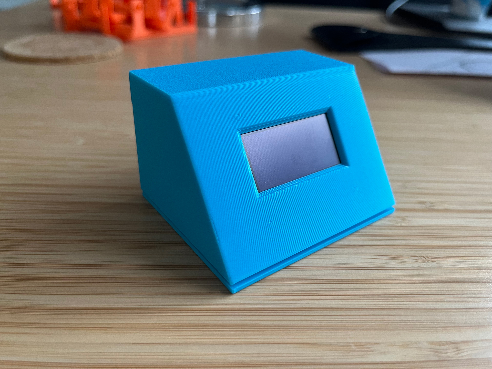
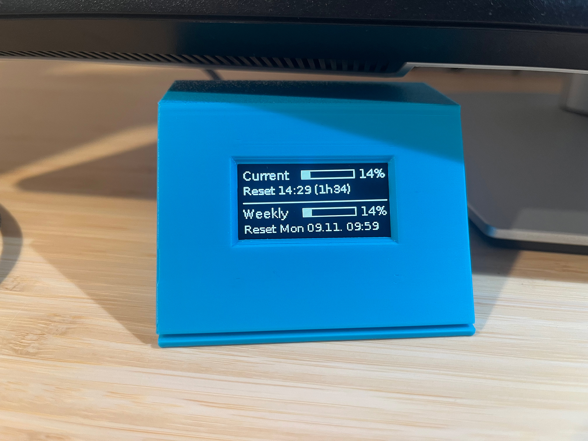
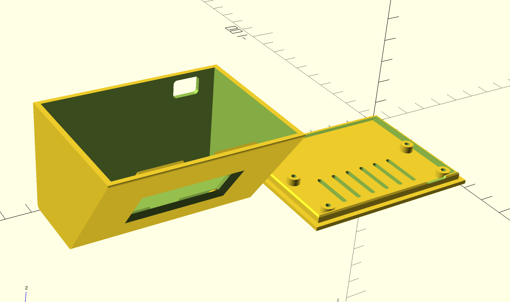
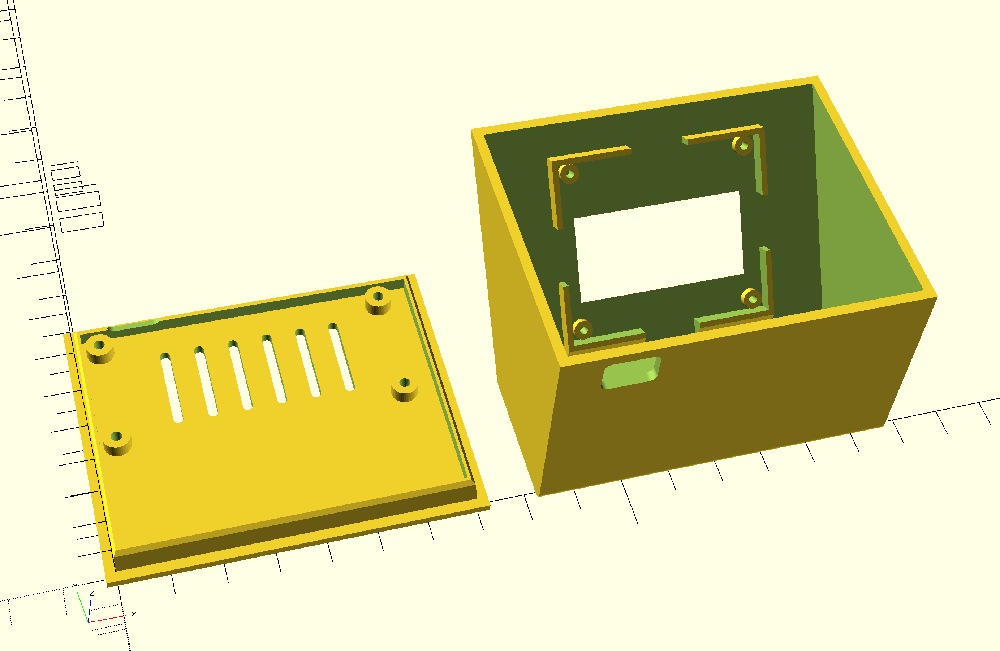
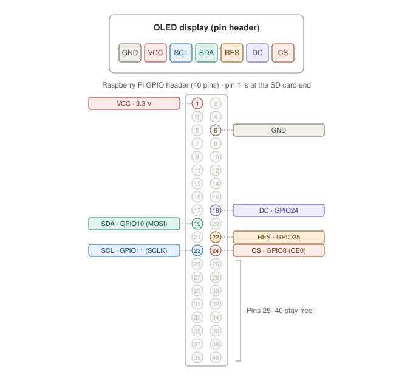

# AI Usage Monitor on a Raspberry Pi Zero W

This guide covers the Raspberry Pi specific steps. Everything both boards have in common (what the display shows, the credentials, sharing the login, common settings) is in the main [README](README.md).

## Hardware

- Raspberry Pi Zero W or Zero 2 W (the plain Zero has no Wi-Fi)
- The 1.54" OLED display ([details](README.md#the-display))
- microSD card, power supply, 7 female-to-female jumper wires (or soldered header)

For the case (optional):

- 3D printer
- 4× M2 screws or 4× M2.5 self-tapping screws (Pi), 4× M2 self-tapping screws (display)

## Case

The [`3Dprint`](3Dprint/) folder contains a 3D-printable desk case. It's a wedge: the display sits in the front face, which leans back 35° like a small monitor. The Pi lies flat on the bottom plate behind it, with its power port in the back wall. With the default settings the case is about 74 × 55 × 52 mm (W × D × H).





*The printed case, switched off and in use.*





## Setup

### 1. Set up the Raspberry Pi

Your Raspberry Pi must already be set up, and you need an SSH connection to it.

### 2. Wire the display

Pin 1 of the Pi header is the corner pin on the SD-card end of the board. Odd pins are on the inner row, even pins on the outer edge.



Pins 25–40 stay free. The pin order on the display itself can differ between sellers, so go by the labels printed on your board.

### 3. Install the software

```bash
sudo raspi-config nonint do_spi 0
sudo apt update
sudo apt install -y git fonts-dejavu-core python3-luma.core python3-luma.oled python3-requests

git clone https://github.com/deluge/ai-usage-monitor.git ~/ai-usage-monitor
```

The display runs with the system-wide `python3`, so the Python packages are installed with `apt` (via `sudo`) instead of a virtual environment.

### 4. Get your Claude login credentials

Follow [Get your Claude login credentials](README.md#get-your-claude-login-credentials) in the main README.

### 5. Save the credentials in the project folder

```bash
cd ~/ai-usage-monitor
nano credentials.json
chmod 600 credentials.json
```

Paste the credentials and change the value after `"expiresAt":` to `0`. The display keeps this file up to date when it refreshes the token. It is listed in `.gitignore`, so it never ends up in Git and `git pull` never touches it.

### 6. Create your settings (optional)

Without settings, the display uses the default for everything. To change something, create `settings.json` in the project folder, next to `credentials.json` (also listed in `.gitignore`), e.g. to turn the picture upside down:

```bash
cp settings.example.pi.json settings.json
nano settings.json
```

```json
{
	"display": {"rotate": 2}
}
```

All settings and their defaults are listed under [Configuration](#configuration).

### 7. Create main.py

`main.py` starts the display. Create it in the project folder (also listed in `.gitignore`):

```bash
nano main.py
```

```python
from display_usage.pizerow.app import main


main()
```

Test it (Ctrl+C to stop):

```bash
python3 main.py
```

### 8. Start on boot

Create the service file:

```bash
sudo nano /etc/systemd/system/usage-monitor.service
```

Paste the following content, replace every `pi` with your username on the Pi, and save:

```ini
[Unit]
Description=Claude usage on OLED
Wants=network-online.target
After=network-online.target

[Service]
User=pi
WorkingDirectory=/home/pi/ai-usage-monitor
ExecStart=/usr/bin/python3 main.py
Restart=always
RestartSec=10

[Install]
WantedBy=multi-user.target
```

Then enable and start the service:

```bash
sudo systemctl daemon-reload
sudo systemctl enable --now usage-monitor
```

### 9. Log in again on your computer

Follow [Log in again on your computer](README.md#log-in-again-on-your-computer) in the main README.

## Updating

```bash
cd ~/ai-usage-monitor
git pull
sudo systemctl restart usage-monitor
```

Your `main.py`, `settings.json` and `credentials.json` stay untouched.

## Configuration

All settings are in `settings.json` in the project folder (step 6). Restart the service after a change: `sudo systemctl restart usage-monitor`.

Each section holds the settings of one part: `display` (the table below), and `timezone`, `api` and `monitor` (see the [main README](README.md#configuration)). Leave out what you don't change. A misspelled setting stops the start with a message in the log (`journalctl -u usage-monitor`).

**`display`**

| Setting | Default | Meaning |
|---|---|---|
| `controller` | `"ssd1309"` | Display controller; use `"ssd1306"` if the display stays black |
| `contrast` | `200` | Display brightness (0–255) |
| `rotate` | `0` | Rotation in steps of 90°; `2` turns the picture upside down |
| `gpio_data_command` | `24` | GPIO of the DC pin |
| `gpio_reset` | `25` | GPIO of the RES pin |
| `spi_port` | `0` | SPI bus |
| `spi_device` | `0` | Chip select: `0` = CE0 (GPIO8), `1` = CE1 (GPIO7) |
| `bus_speed_hz` | `8000000` | SPI clock; lower it if the picture shows glitches |

## Troubleshooting

See also the [common problems](README.md#troubleshooting) in the main README.

| Display / log | Likely cause | Fix |
|---|---|---|
| Stays black | Wrong controller, SPI off or wiring | Set `"controller": "ssd1306"` in the `display` section; check `ls /dev/spidev*`; recheck wiring and 3.3 V |
| `No credentials` | File missing | Create `credentials.json` in the project folder (step 5) |
| `SettingsError: …` | Misspelled setting, invalid value or invalid JSON | Fix `settings.json` (see [Configuration](#configuration)) |
| `Loading...` forever | No network | Check Wi-Fi; see `journalctl -u usage-monitor` |
