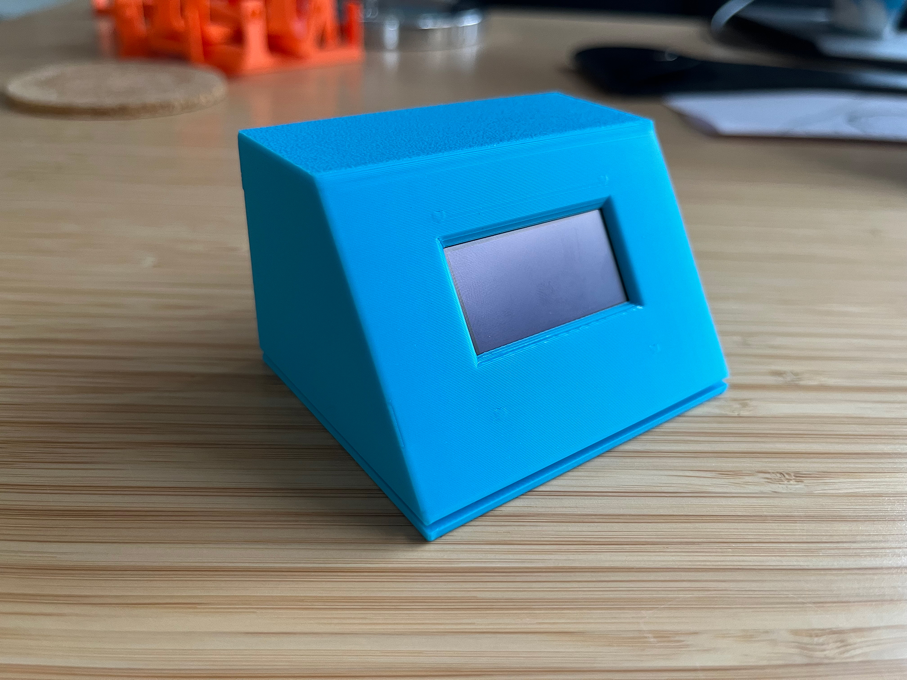
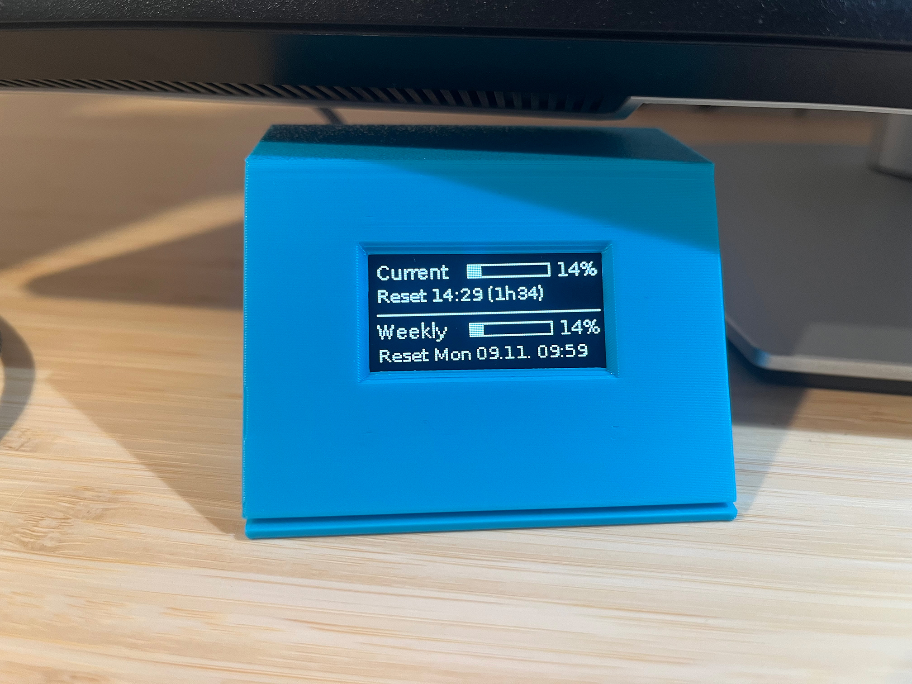
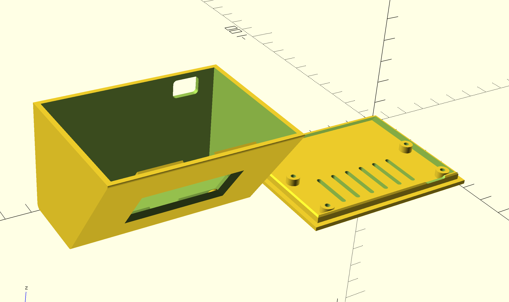
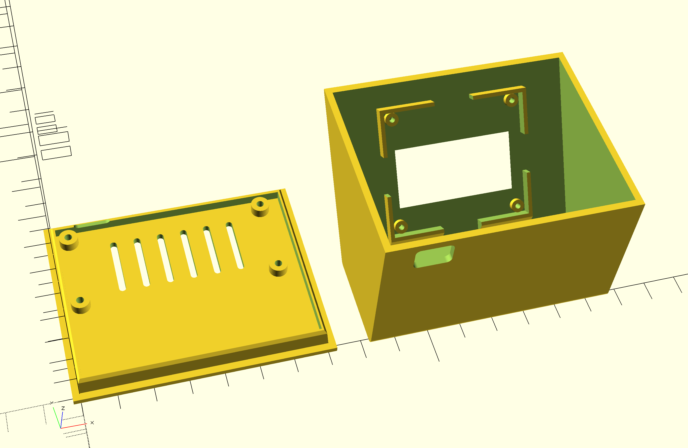
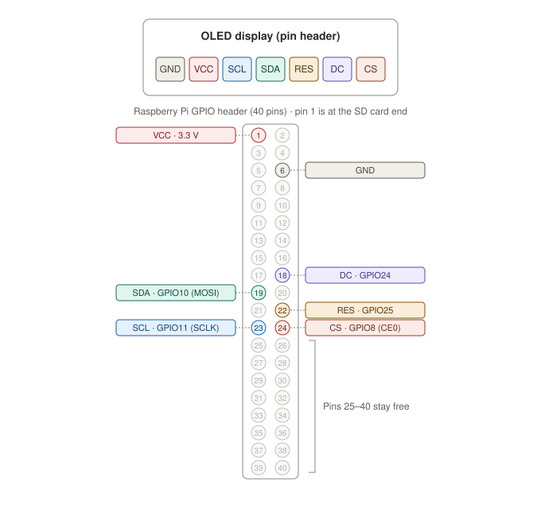

# AI Usage Monitor on a Raspberry Pi Zero W

This guide covers the Raspberry Pi specific steps. Everything both boards have in common (what the display shows, the credentials, sharing the login, common settings) is in the main [README](README.md).

## Hardware

- Raspberry Pi Zero W or Zero 2 W (the plain Zero has no Wi-Fi)
- The 1.54" OLED display ([details](README.md#the-display))
- microSD card, power supply, 7 female-to-female jumper wires (or soldered header)

For the case (optional):

- 3D printer
- 4× M2 screws or 4× M2.5 self-tapping screws (Pi), 4× M2 self-tapping screws (display)

## Case

The [`3Dprint`](3Dprint/) folder contains a 3D-printable desk case. It's a wedge: the display sits in the front face, which leans back 35° like a small monitor. The Pi lies flat on the bottom plate behind it, with its power port in the back wall. With the default settings the case is about 74 × 55 × 52 mm (W × D × H).





*The printed case, switched off and in use.*





## Setup

### 1. Set up the Raspberry Pi

Your Raspberry Pi must already be set up, and you need an SSH connection to it.

### 2. Wire the display

Pin 1 of the Pi header is the corner pin on the SD-card end of the board. Odd pins are on the inner row, even pins on the outer edge.



Pins 25–40 stay free. The pin order on the display itself can differ between sellers, so go by the labels printed on your board.

### 3. Install the software

```bash
sudo raspi-config nonint do_spi 0
sudo apt update
sudo apt install -y git fonts-dejavu-core python3-luma.core python3-luma.oled

git clone https://github.com/deluge/ai-usage-monitor.git ~/ai-usage-monitor
```

The script runs with the system-wide `python3`, so the Python packages are installed with `apt` (via `sudo`) instead of a virtual environment.

### 4. Get your Claude login credentials

Follow [Get your Claude login credentials](README.md#get-your-claude-login-credentials) in the main README.

### 5. Put the credentials on the Pi

```bash
mkdir -p ~/.usage-monitor
nano ~/.usage-monitor/credentials.json
chmod 600 ~/.usage-monitor/credentials.json
```

Paste the credentials and change the value after `"expiresAt":` to `0`.

### 6. Create your start script

`show_my_usage.py` in the project folder starts the display with your own settings. It is listed in `.gitignore`, so `git pull` never overwrites it. Create it:

```bash
nano ~/ai-usage-monitor/show_my_usage.py
```

Paste the following content and save. It uses the default for every setting:

```python
from display_usage.api import ClaudeApi
from display_usage.display import Oled_m154_7p
from display_usage.monitor import UsageMonitor


api = ClaudeApi()
oled = Oled_m154_7p()

monitor = UsageMonitor(api, oled)
monitor.run()
```

To change a setting, pass it to the class. All settings and their defaults are listed under [Configuration](#configuration). For example:

```python
oled = Oled_m154_7p(contrast=100, rotate=2)
```

Test it (Ctrl+C to stop):

```bash
cd ~/ai-usage-monitor
python3 show_my_usage.py
```

### 7. Start on boot

Create the service file:

```bash
sudo nano /etc/systemd/system/usage-monitor.service
```

Paste the following content, replace every `pi` with your username on the Pi, and save:

```ini
[Unit]
Description=Claude usage on OLED
Wants=network-online.target
After=network-online.target

[Service]
User=pi
WorkingDirectory=/home/pi/ai-usage-monitor
ExecStart=/usr/bin/python3 /home/pi/ai-usage-monitor/show_my_usage.py
Restart=always
RestartSec=10

[Install]
WantedBy=multi-user.target
```

Then enable and start the service:

```bash
sudo systemctl daemon-reload
sudo systemctl enable --now usage-monitor
```

### 8. Log in again on your computer

Follow [Log in again on your computer](README.md#log-in-again-on-your-computer) in the main README.

## Configuration

All settings are in your `show_my_usage.py` (step 6). Restart the service after a change: `sudo systemctl restart usage-monitor`.

The `ClaudeApi` and `UsageMonitor` settings are listed in the [main README](README.md#configuration).

**`Oled_m154_7p`**

| Setting | Default | Meaning |
|---|---|---|
| `controller` | `ssd1309` | Display controller; use `ssd1306` if the display stays black |
| `contrast` | `200` | Display brightness (0–255) |
| `rotate` | `0` | Rotation in steps of 90°; `2` turns the picture upside down |
| `gpio_data_command` | `24` | GPIO of the DC pin |
| `gpio_reset` | `25` | GPIO of the RES pin |
| `spi_port` | `0` | SPI bus |
| `spi_device` | `0` | Chip select: `0` = CE0 (GPIO8), `1` = CE1 (GPIO7) |
| `bus_speed_hz` | `8000000` | SPI clock; lower it if the picture shows glitches |

## Troubleshooting

See also the [common problems](README.md#troubleshooting) in the main README.

| Display / log | Likely cause | Fix |
|---|---|---|
| Stays black | Wrong controller, SPI off or wiring | Set `controller="ssd1306"`; check `ls /dev/spidev*`; recheck wiring and 3.3 V |
| `No credentials` | File missing | Create `~/.usage-monitor/credentials.json` (step 5) |
| `Loading...` forever | No network | Check Wi-Fi; see `journalctl -u usage-monitor` |
